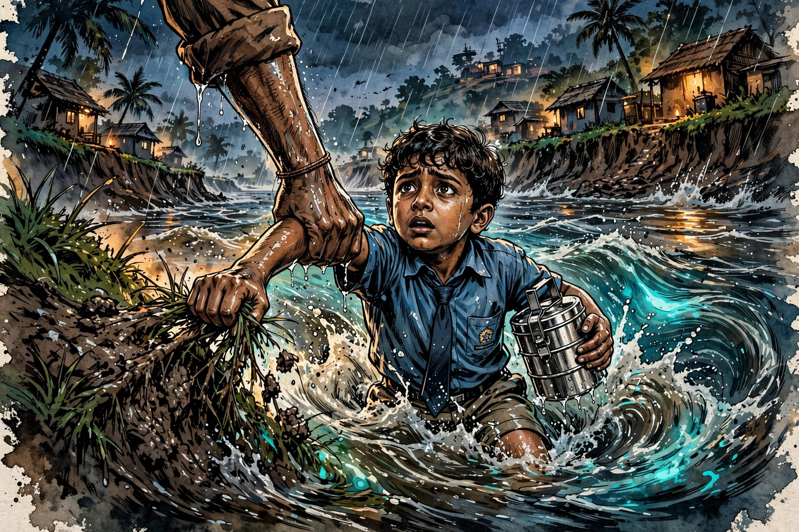

# 🏊 Aqua Slash — Swim Book & Learning Platform

Aqua Slash is a comprehensive, interactive swimming curriculum and learning platform featuring 3D water visualization, structured step-by-step progressions (108 Drops), educational video libraries, and a cloud-synced backend.



---

## 🌟 Key Features

### 1. 🥛 Glass Level (Water Confidence & Safety)
- **3 Levels & 18 Skills (Drops 1–18):** First Splash, Bubble Maker, Fearless Jumper.
- **Interactive 3D Glass Visualization:** Real-time water rise and drop settling as students complete milestones.
- **Coach Approval Lock:** Instructors evaluate students before unlocking drops.

### 2. 🏊 Pool Level (Stroke Coordination & Mechanics)
- **3 Levels & 18 Skills (Drops 1–18):** Water Control, Kick & Body Movement, Basic Stroke Coordination.
- **54 Interactive Quick Questions:** 3 questions per skill to check understanding.
- **Structured Practice Drill Tracker:** Multi-round practice timers and counters.

### 3. 🎬 Swim Video & Media Library
- High-definition 1080p swim technique videos and drills.
- Category filters (Basics, Freestyle, Backstroke, Drills, Water Safety).
- Google Drive sync & IndexedDB local caching for instant playback.

### 4. 🔐 Dual Login & Registration System
- Register using **Name, Email & Mobile Number**.
- Log in seamlessly with either your **Email Address** OR **Phone Number** with the same password.
- Change/Reset passwords anytime with instant local & Google Sheets synchronization.
- Automatic **Admin Role** detection for coach controls.

### 5. ☁️ Google Apps Script & Sheets Backend
- Real-time cloud synchronization for:
  - Student Profiles (`Students`)
  - Login Activity (`Login Activity`)
  - Attendance Logging (`Attendance`)
  - Student Feedback (`Student Feedback`)
  - Media Library (`Media Library`)

---

## 🛠️ Tech Stack

- **Frontend:** React 19, TypeScript, Vite, TailwindCSS v4, Lucide Icons, Canvas 3D
- **Backend:** Google Apps Script Web App (REST API)
- **Database:** Google Sheets (`Aqua Slash — Unified Database`) + IndexedDB + LocalStorage
- **Deployment:** GitHub Pages (Automated via GitHub Actions)

---

## 🚀 Running Locally

```bash
# Clone the repository
git clone https://github.com/dronadulasatish3-arch/-aqua-slash-swim-book-.git

# Install dependencies
npm install

# Start development server
npm run dev
```

Visit `http://localhost:5173` to explore the app.

---

## 📄 License

Proprietary © Satish Dronadula — Aqua Slash Swimming Academy.
